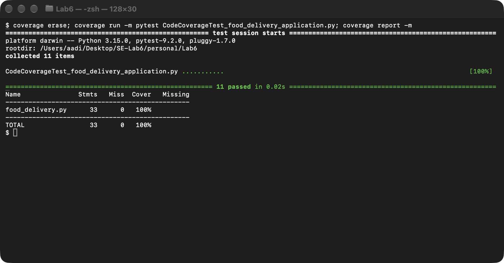
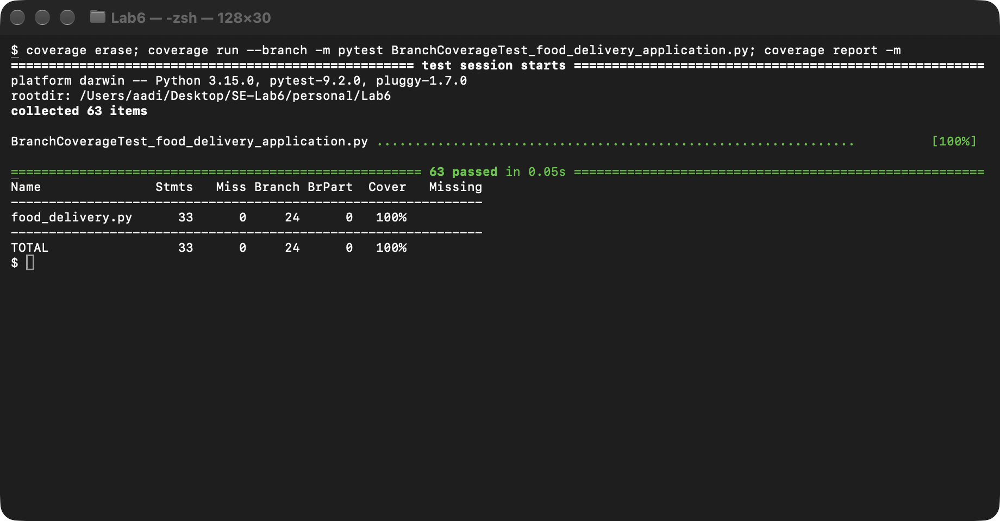

# Lab 6 — Code and Branch Coverage Analysis

**Course:** Software Engineering (PES University, Dept. of CSE) · **Student:** PES1UG24CS569 · **Lab:** 6 — Code and Branch Coverage

| | |
|---|---|
| Assigned repository (L6/L7 #20 — Food Delivery) | https://github.com/SETAPESU26/L6_L7_20_food_delivery |
| Personal submission repository | https://github.com/Sonuaadi0706/SE-Labs-PES1UG24CS569 |

## Objective

Measure how much of the assigned module, `food_delivery.py` (delivery charge, coupons, delivery-time estimate), is exercised by its tests, then write
tests that raise **code (line) coverage** and **branch coverage** from the starter's 36 % / 30 % to at least 90 %. The module is unchanged; only tests were added.

## Results

Python 3.15.0 · coverage 7.17.0 · pytest 9.2.0. `food_delivery.py` has 33 statements and 24 branches (12 decisions × 2 outcomes).

| Test suite | Tests | Line coverage | Branch coverage |
|---|---|---|---|
| Starter `test_food_delivery.py` (baseline) | 2 | 36 % (21 of 33 lines missed) | 30 % |
| **`CodeCoverageTest_food_delivery_application.py`** | 11 | **100 %** (`coverage run`) | 95 % (`coverage run --branch`) |
| **`BranchCoverageTest_food_delivery_application.py`** | 63 | 100 % | **100 %** (24/24 branches, 0 partial) |

### Code coverage (step 6)



All 33 statements execute. The 11 tests are the two starter tests plus the fewest additional cases needed to reach every line: one invalid distance, one free-delivery order, one raining mid-distance order, one far order, an invalid coupon,
a repeat customer using `WELCOME`, a first-order `WELCOME`, a below-minimum order, and a single peak-hour, busy-restaurant time estimate.

### Branch coverage (step 8)



### Line coverage vs. branch coverage in this project

The 100 %-line suite still reports **95 % branch coverage** (`coverage run --branch`), with three partially covered decisions, all in `estimated_time`:

| Missing arc | Meaning | Why the line tests missed it |
|---|---|---|
| `34->36` | `is_peak_hour` is False | the only time test used `is_peak_hour=True` |
| `36->40` | `restaurant_busy` is False | the only time test used `restaurant_busy=True` |
| `38->40` | busy restaurant, but **not** peak hour | needs `(peak=False, busy=True)` |

Every one of those lines *executed*, so line coverage could not see the gap — exactly the point of the handout's calculator example. The branch suite closes them by covering all four
`peak × busy` combinations, takes both outcomes of the other nine decisions, and tests both sides of each boundary (0, 15, 3, 8, 200, 500).

### Does coverage mean the tests are good?

Coverage only proves code ran, not that the assertions would notice a bug. As a one-off check I injected 21 small bugs into a scratch copy of `food_delivery.py`
(for example `<= 3` → `< 3`, `>= 500` → `> 500`, `+= 30` → `+= 20`, `and` → `or`, removing the nested peak check) and ran both suites against each:

| Suite | Bugs caught |
|---|---|
| Code-coverage suite (100 % lines) | 16 / 21 |
| Branch-coverage suite (100 % branches) | **21 / 21** |

The five bugs the line-coverage suite let through are all **boundary** mistakes (`> 15` → `>= 15`, `>= 500` → `> 500`, `<= 3` → `< 3`, `<= 8` → `< 8`, `< 200` → `<= 200`), because
it never tests a value on the boundary itself. This is why the branch suite includes boundary values.

## Test design (branch suite)

| Function | Decisions covered | Boundary / key values |
|---|---|---|
| `delivery_charge` | `distance <= 0`, `distance > 15`, `order_value >= 500`, `distance <= 3`, `distance <= 8`, `is_raining` | 0, −1, 0.1, 15, 15.01 · 3, 3.01, 8, 8.01 · 499.99, 500 · rain on/off in every tier and with free delivery |
| `apply_coupon` | `code is None`, `code not in COUPONS`, `WELCOME and not first order`, `order_value < 200` | `None`, unknown / mis-cased codes · `WELCOME` for first vs repeat customer · `SAVE50` for either · 199.99, 200, 200.01 |
| `estimated_time` | `is_peak_hour`, `restaurant_busy`, nested `is_peak_hour` | all four peak × busy combinations · distance 0, 2.5, 5, 15 |

## Deliverables

| Deliverable (handout) | File |
|---|---|
| Coverage analysis — terminal screenshots (code, branch) | [`screenshots/code_coverage.png`](screenshots/code_coverage.png), [`screenshots/branch_coverage.png`](screenshots/branch_coverage.png) |
| Test cases for code coverage | [`CodeCoverageTest_food_delivery_application.py`](CodeCoverageTest_food_delivery_application.py) |
| Test cases for branch coverage | [`BranchCoverageTest_food_delivery_application.py`](BranchCoverageTest_food_delivery_application.py) |
| Application under test (unchanged) / starter tests (unchanged) | [`food_delivery.py`](food_delivery.py), [`test_food_delivery.py`](test_food_delivery.py) |
| Minimum 2 commits — one per coverage level | see below |

Screenshots were taken only after reaching ≥ 90 %, as the handout asks; the 36 % / 30 % baseline is recorded in the table above as text.

## Commits

| # | Commit | Result |
|---|---|---|
| 0 | `ec357f6` Lab6: add assigned food delivery module and starter tests | baseline — 36 % line, 30 % branch |
| 1 | `04bb5bf` Lab6: add code coverage tests (36% -> 100% line coverage) | **code coverage** test file + screenshot |
| 2 | `f66836b` Lab6: add branch coverage tests (100% branch coverage) | **branch coverage** test file + screenshot |
| 3 | Lab6: add Lab 6 README and root README entry | documentation |

## Reproduce

```bash
pip install coverage pytest
cd Lab6

# code (line) coverage
coverage run -m pytest CodeCoverageTest_food_delivery_application.py
coverage report -m

# branch coverage
coverage run --branch -m pytest BranchCoverageTest_food_delivery_application.py
coverage report -m
```

`.coveragerc` limits the report to `food_delivery.py`, so the figures describe the application rather than the test files that import it.
