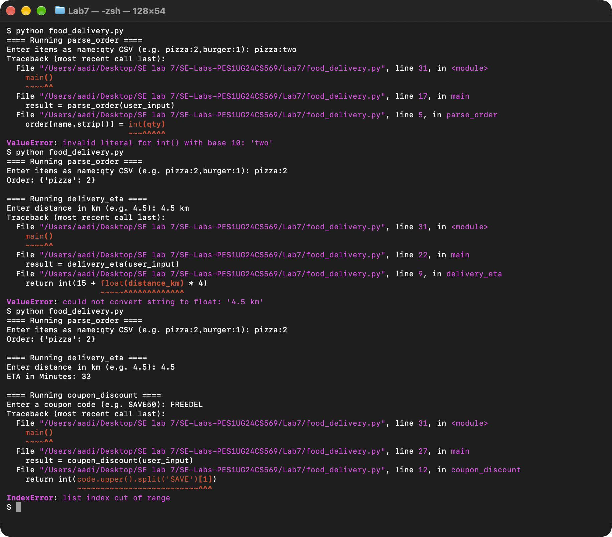
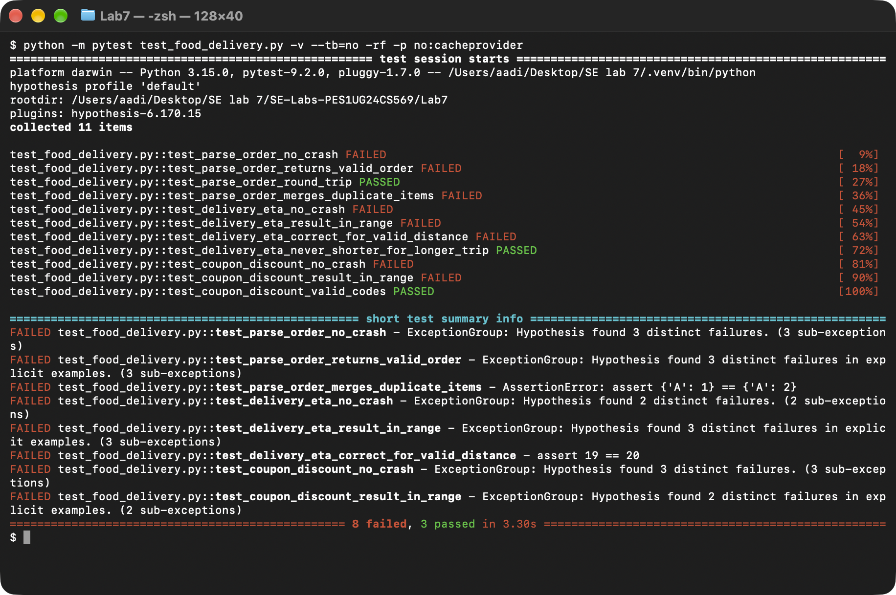
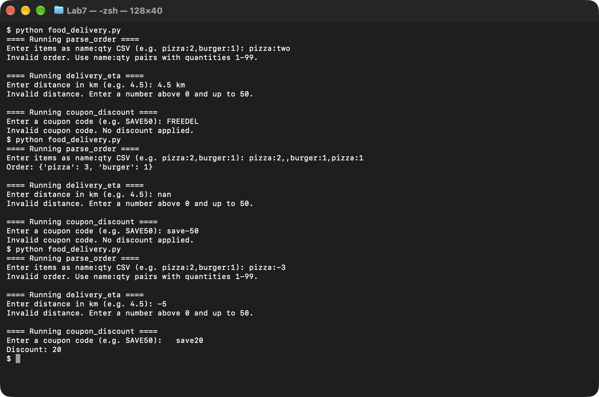
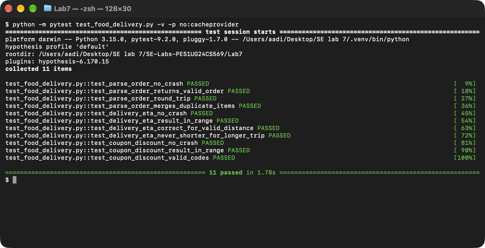

# Lab 7 — Fuzzing for Input Validation Bugs

**Course:** Software Engineering (PES University, Dept. of CSE) · **Student:** PES1UG24CS569 · **Lab:** 7 — Fuzz Testing with Hypothesis

| | |
|---|---|
| Assigned repository (L6/L7 #20 — Food Delivery) | https://github.com/SETAPESU26/L6_L7_20_food_delivery |
| Personal submission repository | https://github.com/Sonuaadi0706/SE-Labs-PES1UG24CS569 |

## Objective

Use property-based fuzzing with **Hypothesis** to find input-validation bugs in the assigned module, `food_delivery.py`, then
harden its three functions so that no input can crash them or make them return an impossible value:

| Function | Purpose |
|---|---|
| `parse_order(items_csv)` | turn `"pizza:2,burger:1"` into `{'pizza': 2, 'burger': 1}` |
| `delivery_eta(distance_km)` | delivery time in minutes: 15 + 4 per km |
| `coupon_discount(code)` | discount amount from a `SAVE<n>` coupon code |

In this repository the handout's `processor.py` / `test_processor.py` are named `food_delivery.py` / `test_food_delivery.py`.

## Results

Python 3.15.0 · Hypothesis 6.170.15 · pytest 9.2.0 · 500 generated inputs per test.

| Run | Fuzz tests | Result |
|---|---|---|
| Buggy `food_delivery.py` | 11 | **8 failed**, 3 passed — crashes in all three functions |
| Fixed `food_delivery.py` | 11 | **11 passed** (also checked with 6 different random seeds and a 20,000-input stress run per function) |

The PDF with all screenshots is [`Lab7_FuzzTesting_Report.pdf`](Lab7_FuzzTesting_Report.pdf).

### Step 2 — buggy program

Valid input works ([`01`](screenshots/01_buggy_run_valid_input.png)), but one bad value crashes the whole program, one per function:



### Step 4 — fuzz tests on the buggy program



Hypothesis shrinks every failure to the smallest input that triggers it. For example, for `coupon_discount` it found three
different crashes from `'SAVE'`, `''` and `None` ([`04`](screenshots/04_fuzz_failure_detail_coupon.png)). The full log is in
[`logs/pytest_before_fix.txt`](logs/pytest_before_fix.txt).

### Step 5 — fixed program



Valid input still gives the same answers as before ([`05`](screenshots/05_fixed_run_valid_input.png)). Bad input now gets a clear
message instead of a traceback. Duplicate items are added together (`pizza:2,,burger:1,pizza:1` → `{'pizza': 3, 'burger': 1}`).

### Step 6 — fuzz tests on the fixed program



Full log: [`logs/pytest_after_fix.txt`](logs/pytest_after_fix.txt).

## Bugs found

| # | Function | Failing input | Buggy behaviour | Found by |
|---|---|---|---|---|
| 1 | `parse_order` | `None` | `AttributeError: 'NoneType' object has no attribute 'split'` | fuzzer |
| 2 | `parse_order` | `''`, `'pizza:2,'` | `ValueError: not enough values to unpack` (no `:` / empty item) | fuzzer |
| 3 | `parse_order` | `':'` | `ValueError: invalid literal for int()` (empty quantity) | fuzzer |
| 4 | `parse_order` | `'pizza:two'`, `'a:1:2'` | `ValueError` (non-numeric quantity / too many `:`) | pinned example / by hand |
| 5 | `parse_order` | `'pizza:-3'` | accepted a **negative quantity** `{'pizza': -3}` | pinned example |
| 6 | `parse_order` | `'pizza:' + '9'*5000` | `ValueError: Exceeds the limit (4300 digits)` — oversized input | pinned example |
| 7 | `parse_order` | `'A:1,A:1'` | repeated item **overwritten**: `{'A': 1}` instead of `{'A': 2}` | fuzzer |
| 8 | `delivery_eta` | `None` | `TypeError: float() argument must be ... not 'NoneType'` | fuzzer |
| 9 | `delivery_eta` | `''`, `'4.5 km'` | `ValueError: could not convert string to float` | fuzzer |
| 10 | `delivery_eta` | `'nan'` / `'inf'` | `ValueError` / `OverflowError` when converting to `int` | pinned example |
| 11 | `delivery_eta` | `'-5'`, `'1e3'` | impossible ETAs: **−5 min**, 4015 min | pinned example / by hand |
| 12 | `delivery_eta` | `1.125` | 19.5 min was **truncated** to 19 (under-promises); rounds up to 20 now | fuzzer |
| 13 | `coupon_discount` | `None` | `AttributeError: 'NoneType' object has no attribute 'upper'` | fuzzer |
| 14 | `coupon_discount` | `''`, `'FREEDEL'` | `IndexError: list index out of range` (no `SAVE`) | fuzzer |
| 15 | `coupon_discount` | `'SAVE'` | `ValueError: invalid literal for int()` (no amount) | fuzzer |
| 16 | `coupon_discount` | `'SAVE-50'`, `'SAVE99999'`, `'XSAVE50'` | **negative**, unlimited, or prefixed codes accepted | pinned example |

"Pinned example" means the input is fixed in the test with `@example(...)` so it is always checked as a regression test, on top of
the random inputs. "By hand" inputs (`'a:1:2'`, `'1e3'`) were confirmed by calling the original function directly.

## Fixes

None of the functions raise any more. Invalid input returns a clear "invalid" value that `main()` reports to the user:

| Function | Valid input | Invalid input returns | Validation added |
|---|---|---|---|
| `parse_order` | `name:qty` items separated by commas; blank items skipped; repeats added together | `{}` | must be a `str`; exactly one `:` per item; name non-empty and printable; quantity is 1–2 ASCII digits (regex), total 1–99 per item |
| `delivery_eta` | a number, or a plain decimal string like `"4.5"`, in (0, 50] km | `None` | rejects `bool`, `None`, other types; string must match `\d{1,3}(\.\d{1,6})?`, so units, signs, `nan`, `inf`, `1e3` are rejected; finite-range check; result rounded **up** with `math.ceil` |
| `coupon_discount` | `SAVE<n>` in any letter case, surrounding spaces ignored, `n` = 1–100 | `0` | must be an ASCII `str`; whole code must match `SAVE([0-9]{1,3})` (`fullmatch`, not `split`); amount range check |

`main()` also catches `EOFError` / `KeyboardInterrupt` so pressing Ctrl+D or Ctrl+C exits cleanly.

**Validating digits with a regex instead of only `int()`/`float()`** matters here: Python's `int()` accepts `'-3'`, `'+3'`, `'1_0'`,
Unicode digits such as `'٣'`, and surrounding spaces, and `float()` also accepts `'nan'`, `'inf'` and `'1e3'`. Checking the
characters first closes all of these, and limiting the length also blocks the 4300-digit crash.

## Test design

`test_food_delivery.py` keeps the three tests from the starter template and adds eight property tests:

| Test | Input strategy | Property checked |
|---|---|---|
| `test_parse_order_no_crash` (template) | `st.text() \| st.none()` | never raises |
| `test_parse_order_returns_valid_order` | any type + order-like text + pinned examples | result is a dict of non-empty names → int 1–99 |
| `test_parse_order_round_trip` | random valid orders | `parse_order(csv)` gives back the same dict |
| `test_parse_order_merges_duplicate_items` | name, two quantities | `A:1,A:2` → `{'A': 3}` |
| `test_delivery_eta_no_crash` (template) | `st.text() \| st.none()` | never raises |
| `test_delivery_eta_result_in_range` | any type + number-like text + pinned examples | `None`, or an int from 15 to 215 |
| `test_delivery_eta_correct_for_valid_distance` | floats in (0, 50] | equals `ceil(15 + 4·d)` for the number and its string form |
| `test_delivery_eta_never_shorter_for_longer_trip` | two distances | a longer trip never gets a shorter ETA |
| `test_coupon_discount_no_crash` (template) | `st.text() \| st.none()` | never raises |
| `test_coupon_discount_result_in_range` | any type + coupon-like text + pinned examples | an int from 0 to 100 |
| `test_coupon_discount_valid_codes` | 1–100, upper/lower/title case | `SAVE<n>` returns `n` |

"Order-like", "number-like" and "coupon-like" strategies build text mostly from characters the parser cares about (`:`, `,`,
digits, `-`, `SAVE` …). Plain `st.text()` rarely produces these, so this helps the fuzzer get past the first check and reach deeper code.

While testing the fix, Hypothesis also found an edge case in the first version of the range test: for a tiny distance such as
`5.7e-55` km, `15 + 4·d` rounds to exactly `15.0` in floating point, so the ETA is 15 minutes. That is correct, so the test's lower
bound was changed from `> 15` to `>= 15`.

## Deliverables

| Deliverable (handout) | File |
|---|---|
| 1. PDF document with the screenshots | [`Lab7_FuzzTesting_Report.pdf`](Lab7_FuzzTesting_Report.pdf) (screenshots also in [`screenshots/`](screenshots/)) |
| 2. Fixed application Python script | [`food_delivery.py`](food_delivery.py) |
| 3. Updated test script | [`test_food_delivery.py`](test_food_delivery.py) |
| Full pytest output before / after the fix | [`logs/pytest_before_fix.txt`](logs/pytest_before_fix.txt), [`logs/pytest_after_fix.txt`](logs/pytest_after_fix.txt) |

## Commits

| # | Commit | Result |
|---|---|---|
| 1 | `7547797` Lab7: add assigned food delivery module, starter fuzz tests and buggy-run screenshots | step 2 — buggy program output |
| 2 | `c11f3fb` Lab7: complete Hypothesis fuzz tests (8 of 11 fail on the buggy module) | steps 3–4 — tests and failing run |
| 3 | `dc09c50` Lab7: harden food_delivery.py against fuzzed inputs (all 11 fuzz tests pass) | steps 5–6 — fixed program and passing run |
| 4 | Lab7: add PDF report, README and root README entry | documentation |

## Reproduce

```bash
pip install hypothesis pytest
cd Lab7

python food_delivery.py              # step 2 / 5
python -m pytest test_food_delivery.py -v   # step 4 / 6
```

To see the failures again, check out the original module with `git show 7547797:Lab7/food_delivery.py > food_delivery.py`.
